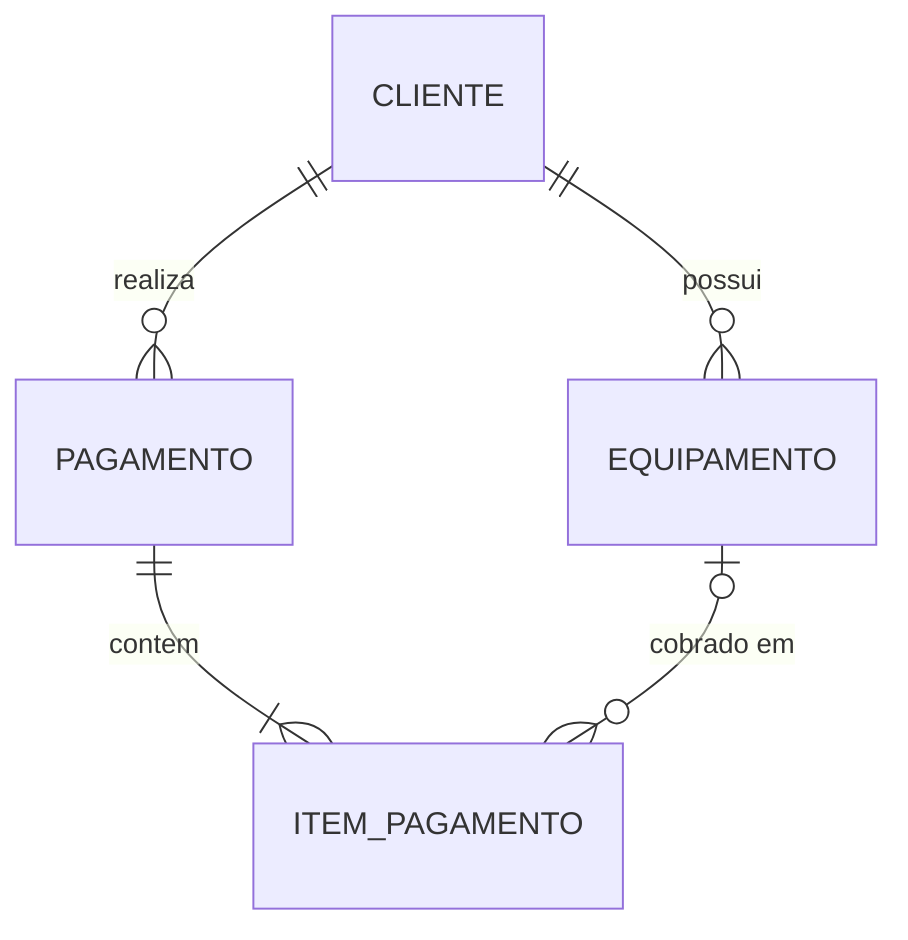

# Sistema de Manutenção de Extintores

Sistema desktop para uma pequena empresa de manutenção de extintores de incêndio. Ele organiza o cadastro de clientes e equipamentos, avisa o que está vencido ou perto de vencer e controla os pagamentos, no lugar das planilhas que a empresa usava.

Projeto desenvolvido como estágio, para uso interno por **uma pessoa**, em **um computador**, sem depender de internet.

## Funcionalidades

### Vencimentos
Painel inicial com o que precisa de atenção:
- Três cartões: **vencidos**, **vencem em até 30 dias** e **em dia**.
- Tabela ordenada do mais atrasado para o menos, com o prazo escrito ("venceu há 67 dias", "vence em 6 dias") e o **telefone do cliente**.
- Filtro por situação e busca por cliente ou número de série.

### Clientes
- Pessoa física e jurídica, com seletor **CPF/CNPJ**, máscara automática e **validação dos dígitos verificadores** (aceita também CNPJ alfanumérico).
- Telefone e e-mail validados e formatados.
- Busca por nome ou por CPF/CNPJ (com ou sem pontuação).
- Edição e exclusão pela própria lista. Um cliente que já tem equipamentos ou pagamentos não pode ser excluído.
- A **última forma de pagamento** e o **último valor cobrado** aparecem na lista, calculados a partir do pagamento mais recente, sem digitação.

### Equipamentos
- Extintores e mangueiras ligados a um cliente, com descrição, capacidade, número de série e a data da última manutenção, venda ou teste.
- O **vencimento é calculado** (data + 12 meses) e a situação aparece em cores.
- Busca por cliente ou número de série, e escolha do cliente por nome ou documento.

### Pagamentos
- Um pagamento por visita, com **itens de preço individual**: manutenção, venda de extintor, venda de mangueira, teste de mangueira e venda de placa.
- Formas: dinheiro, PIX, boleto, cartão de débito e cartão de crédito. Vencimento, data do pagamento e número da nota fiscal (somente registro).
- Situação deduzida pelas datas: **pago**, **pendente** ou **atrasado** (sem multa e sem juros).
- Cartões com o valor a receber, o valor em atraso e o recebido no mês. Filtros por situação e por forma de pagamento.
- Registrar manutenção, venda ou teste de um equipamento **atualiza a data dele**, e o vencimento é recalculado sozinho.
- Sugestão da última forma de pagamento do cliente e do último valor cobrado de cada equipamento.

### Backup
- Cópia de segurança do banco para uma pasta escolhida, com data e hora no nome.
- A cópia é **verificada** logo depois de criada e descartada se estiver corrompida.
- Backup automático ao fechar o programa (no máximo um por dia). Os 30 mais recentes são guardados.
- Instruções de restauração na própria tela.

## Tecnologias

- **Python 3** (desenvolvido no Windows com Python 3.15)
- **CustomTkinter** para a interface
- **SQLite** para o banco de dados (já vem com o Python)

## Como executar

Pré-requisito: Python 3.10 ou superior instalado (com a opção "Add Python to PATH" marcada).

```powershell
git clone https://github.com/gMiranda14/sistema-extintores.git
cd sistema-extintores
python -m venv venv
venv\Scripts\activate
pip install -r requirements.txt
python main.py
```

Se o PowerShell bloquear a ativação do ambiente virtual, rode antes:

```powershell
Set-ExecutionPolicy -Scope CurrentUser RemoteSigned
```

Na primeira execução o banco é criado vazio, em `banco/dados.db`. Se existir o arquivo `assets/logo.ico`, ele é usado como ícone do programa. Sem ele, o sistema abre normalmente.

## Estrutura do projeto

```
sistema-extintores/
├── main.py              # janela principal e menu
├── requirements.txt
├── banco/
│   └── conexao.py       # conexão e criação das tabelas
├── modelos/             # consultas ao banco
│   ├── cliente.py
│   ├── equipamento.py
│   └── pagamento.py
├── regras/              # regras de negócio
│   ├── backup.py
│   ├── financeiro.py    # valores em reais e situação do pagamento
│   ├── validadores.py   # CPF, CNPJ, telefone, e-mail e máscaras
│   └── vencimentos.py   # cálculo de vencimento e prazos
└── telas/               # interface
    ├── tela_vencimentos.py
    ├── tela_clientes.py
    ├── tela_equipamentos.py
    ├── tela_pagamentos.py
    └── tela_backup.py
```

## Modelo de dados



Um item de pagamento pode não ter equipamento (por exemplo, a venda de uma placa de sinalização).

## Regras de negócio

- **Vencimento** de extintores e mangueiras: data da última manutenção, venda ou teste **+ 12 meses**.
- **Alerta:** o equipamento aparece em "vence em breve" quando faltam 30 dias ou menos, e em "vencido" depois da data.
- **Pagamento:** *pago* quando há data de pagamento; *atrasado* quando não foi pago e o vencimento já passou; *pendente* nos demais casos.
- **Renovação:** salvar um pagamento com manutenção, venda ou teste atualiza a data do equipamento. A data só avança, nunca volta.

## Dados e segurança

- O sistema é local, **não usa internet** e não envia dados a ninguém.
- Os comandos ao banco usam parâmetros, o que protege contra SQL injection.
- O banco **não é criptografado**. A proteção dos dados depende do computador: usuário do Windows com senha e disco criptografado (BitLocker).
- O backup contém dados pessoais (CPF, telefone e endereço): use uma pasta protegida, com verificação em duas etapas, e não a compartilhe por link.
- O banco em uso **não deve ficar numa pasta sincronizada** (Dropbox, OneDrive). Só as cópias de backup vão para a nuvem.
- O `.gitignore` impede que `banco/dados.db`, `config.json`, planilhas e a pasta `assets/` sejam enviados ao repositório. Os dados reais da empresa nunca fazem parte do projeto.
- Os dados de teste e as capturas de tela usam informações fictícias.

## Fora do escopo

- Emissão de nota fiscal (a empresa já usa outros sistemas; aqui existe só o campo de registro do número).
- Avisos automáticos aos clientes.
- Uso por vários usuários ao mesmo tempo.

## Próximos passos

- [ ] Relatórios: clientes ativos, vencimentos do mês e faturamento do período.
- [ ] Importação dos dados das planilhas atuais, se necessário.
- [ ] Empacotamento em executável (`.exe`) para a instalação na empresa.
- [ ] Controle de acesso ao programa (opcional).

<!-- Quando quiser, adicione capturas de tela (com dados fictícios) numa pasta docs/imagens e referencie aqui:

-->

## Autor

Desenvolvido por [gMiranda14](https://github.com/gMiranda14).